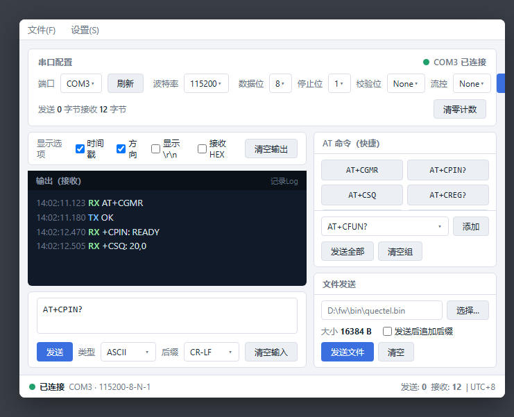

# eCOM — User Guide

> For end users. This document uses text + schematic images to explain operations; for real interface screenshots that cannot be auto-generated, see the "Screenshot Requirements" section at the end — fill them in to replace the corresponding placeholders.

---

## 1. Interface Overview

> The image below is a **design-mockup render** (not a real screenshot); the actual running window may differ. For real screenshots, see the fill-in list at the end.



```
+----------------------------------------------------------------------------+
| Menubar:  File | View | Language | Help                                    |
+------------------------------+---------------------------------------------+
|  [Mode: AT] [Stress] [File]  |   AT / Stress / File content (by mode)      |
|------------------------------|                                             |
| Serial config card           |   ① AT command list (paged/select/codec     |
|  Port [COM78  USB...]    |      /suffix/HEX/Enter/interval/expected)   |
|  Baud 115200 · Data 8        |      [Prev] [Next] [Select All] [Add Page]  |
|  Parity None · Stop 1        |   ② Quick-command area (click=send /        |
|  Flow None  ·  DTR/RTS       |      right-click=manage)                    |
|  [Open Serial]  [Refresh]    |   ③ Custom check rules                      |
+------------------------------+---------------------------------------------+
| TX/RX output area (TX blue / RX green, scrollable)                        |
+----------------------------------------------------------------------------+
| Status bar: connected · TX n bytes · RX n bytes · [status dot]              |
+----------------------------------------------------------------------------+
```

> The left column holds serial config & status; the right column switches content by mode. The window is resizable; font size is adjustable via the View menu.

---

## 2. Install & Launch

1. Install Python ≥ 3.8 (official installer on Windows; also `python3-tk` on Linux, see the project overview).
2. `pip install pyserial` (or `pip install .`).
3. Launch: `python main.py`, or `ecom start` after install.
4. Exit: close the window or press `Ctrl+C` in the terminal.

> ⚠️ If tkinter is missing: on Linux run `sudo apt install python3-tk` (or the distro-specific command).

---

## 3. Connect the Serial Port

1. In the left "Serial config card", select the **port** (dropdown shows full device name, e.g. `COM78  USB Serial Port`).
2. Set **baud / data bits / parity / stop bits / flow control** (default 115200·8·None·1·None).
3. Optionally check **DTR/RTS** (checked = pulled low).
4. Click "Open Serial"; the button becomes "Close Serial" and the status bar light turns on showing connected.

> Can't open: check whether the port is in use (another tool already opened it), whether the baud matches the device, and read/write permissions (add yourself to the `dialout` group on Linux).

---

## 4. AT Command Debugging (AT mode)

- Type an AT command, choose the **send type** (ASCII/HEX/DEC/BIN) and **send-on-enter suffix** (None/CR/LF/CR-LF/SPACE/STX-ETX/NULL).
- Click "Send" or press Enter; the output area shows **TX (blue) / RX (green)** in real time.
- Display options: show timestamp, direction, CRLF escape, HEX — switchable in the View menu.
- Use "Start/Stop Log" to write TX/RX records to a file (byte-identical to the output box).

---

## 5. AT List Management & Looped Send

**AT List** is an editable command table; each row has: check(participate), AT command, send type, suffix, HEX, Enter, interval(ms), expected, match mode.

- Double-click a row to **send it**; right-click to **edit**.
- Bottom has "Prev / Next / Select All / Add Page"; **Add Page** appends a blank page.
- Set **run count** and **interval(ms)**, then click "Run" to loop-send checked rows; "Stop" terminates.
- **Export/Import** command groups (JSON) to the left command-group dropdown for quick reuse.

---

## 6. Stress Mode (Core Feature)

> Switch to "Stress" mode; the right column shows stress config + stress AT list + output stats.

### 6.1 Config area

| Config | Description |
|---|---|
| Stress name | name of the plan (shown in the log header) |
| End-by | **Count** (run N rounds) or **Time** (up to N minutes) |
| Row interval(ms) | **global default** row interval; a row with its own interval wins |
| Response timeout(ms) | end-of-stream decision: silence beyond this means the response finished |

### 6.2 Stress AT list

Same as AT list, plus:

- **Interval**: each row may set its own `interval_ms`; **>0 takes priority over the global row interval**, 0 means use the global. The interval is the wait after that row finishes.
- **Expected**: defaults to `OK`; can be edited to several (separated by `|`); match mode contains/regex/exact. **An empty expected is compared as `OK`**, to avoid "no check".

### 6.3 Start / Pause / Stop

- Click "Start" to run; while running, the Start button shows the current **round number** (green bold).
- "Stop" finishes and prints a summary.

### 6.4 Structure of the run log

The log is segmented per round, with a separation marker on each round's first line for easy per-round verification:

```
=== name:StressTest1 | count=5 | interval(ms):300 | timeout(ms):2000 ===
=================== Runtimes 1 ===================
[2026-08-26_13:47:23:903]  TX  AT
[2026-08-26_13:47:24:019]  RX  AT
[2026-08-26_13:47:24:022]  RX  OK
=================== Runtimes 2 ===================
...
== Summary ==
Stress name: StressTest1
Duration: 0.0H
Run window: 2026-08-26 13:47:23.900387~2026-08-26 13:47:28.197361
Total rounds: 5
Sent: 10
Errors: 0
```

- **Runtimes N**: marker for the start of round N.
- **Errors**: expected-mismatch count + check-rule hits.
- **Duration**: in hours with 1 decimal (`0.0H`).

### 6.5 Custom check rules

The "custom check rules" area lets you configure keyword rules; a hit is flagged as an exception and recorded to the target (AT/DOS/BOTH). Built-in examples:

- Module abnormal reboot → `RDY`
- Response contains ERROR → `ERROR`

Rules can be added/deleted (disabled by default, enable when needed).

---

## 7. File Transfer

Switch to "File" mode: pick a local file → click "Send" to write it to the serial port in chunks, with a **progress bar** and **Pause/Resume**; "Cancel" aborts. After finishing you can send again.

---

## 8. Language Switch

Menu "Language" → choose **中文 / English** to switch in real time. This refreshes the main UI text; some newly-added/complex controls may not follow the switch (see Known Issues & Leftover Items).

---

## 9. FAQ

| Phenomenon | Handle |
|---|---|
| Can't open port | port in use / wrong baud / no permission (add dialout group on Linux) |
| No data received | check DTR/RTS, baud, whether device echoes; confirm display options not disabled |
| Stress doesn't verify | empty expected compares as `OK`; confirm the row is checked and the command is non-empty |
| No summary | need to satisfy the end condition and run at least one round |
| UI text not refreshing with language | see Known Issues & Leftover Items |

---

## 10. Screenshot Requirements (fill in to replace the placeholders)

> I cannot generate the real running GUI screenshots (they require the app to actually run). Please open `python main.py` locally and capture per this list, then save into `docs/images/` and replace the placeholder images.

| # | Screenshot target | Recommended content | Used in |
|---|---|---|---|
| S1 | Main window (AT mode) | full window, serial card + AT list + output | Interface overview |
| S2 | Serial config card | port dropdown, baud/parity/flow, DTR/RTS | §3 Connect |
| S3 | AT list close-up | a few rows incl. check/codec/suffix/HEX/Enter/interval/expected | §5 |
| S4 | Stress config area | name/end-by/row interval/timeout | §6.1 |
| S5 | Stress run output | `=== ... ===`, `Runtimes N`, TX/RX, `== Summary ==` | §6.4 |
| S6 | Check-rule editor | rule rows (name/keyword/target/exception/enabled) | §6.5 |
| S7 | File-send panel | file picked, progress, pause/resume | §7 |
| S8 | English UI | main window after switching to English | §8 |

> Suggested each image ~1280px wide, readable; name them `S1.png`…`S8.png` to match the table.
